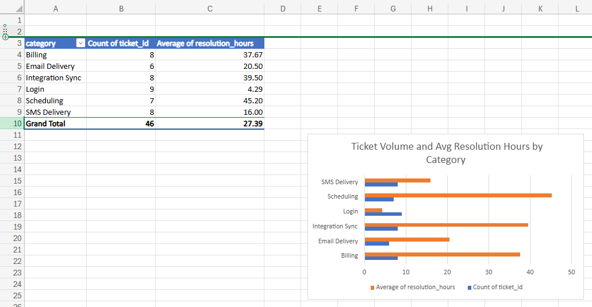
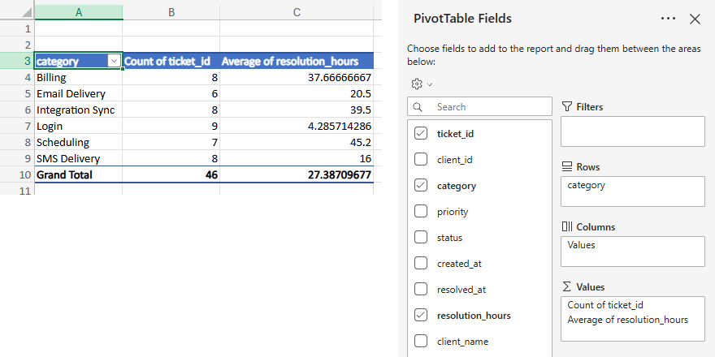
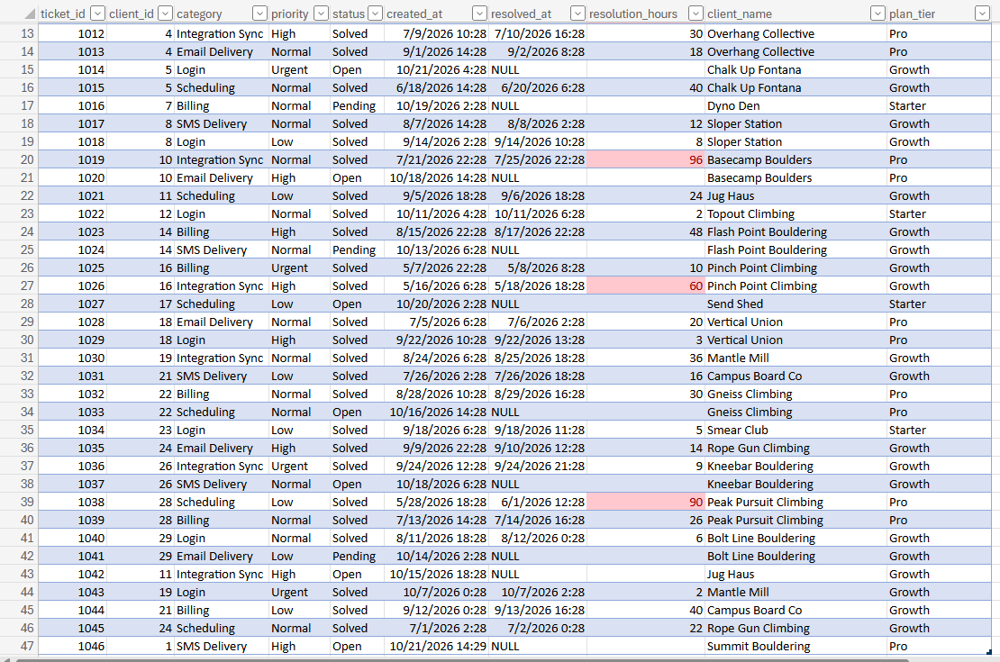
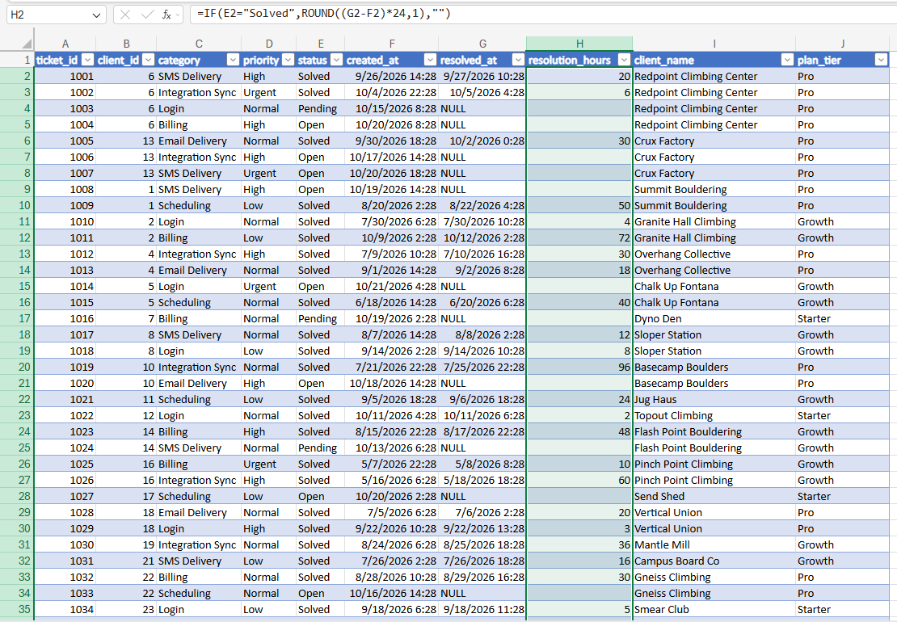
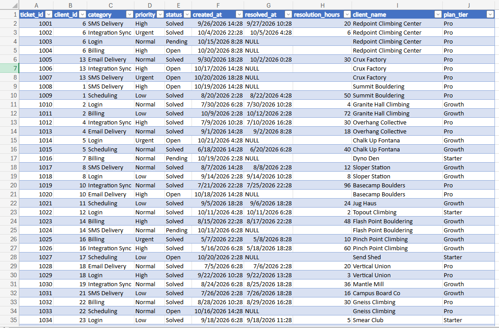
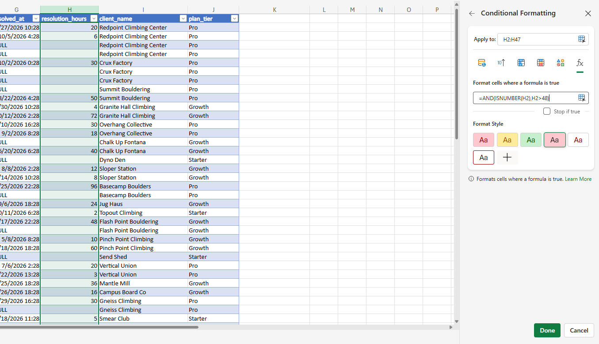
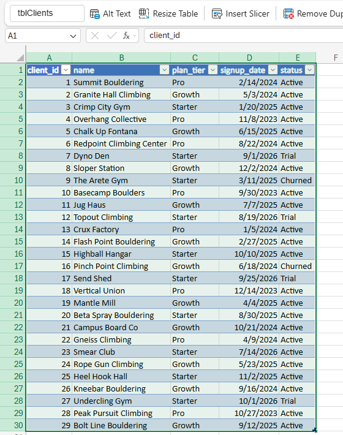
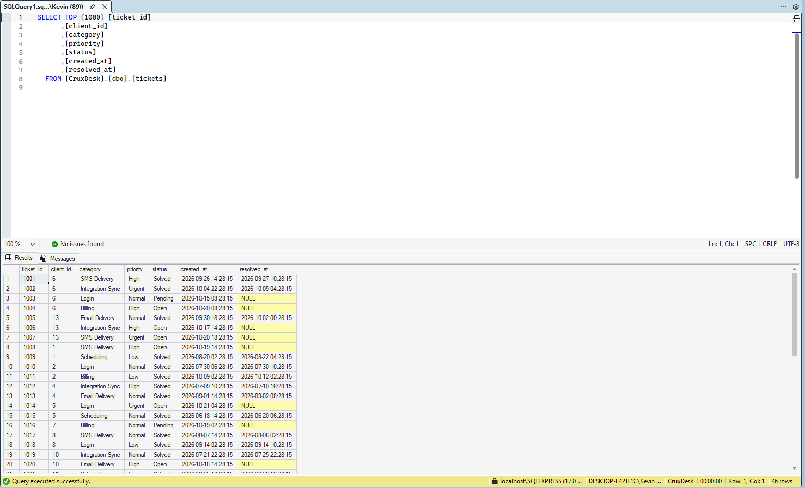

# CruxDesk Ticket Report (Excel)

A support reporting workbook built in Excel for the web from the CruxDesk SQL Server database. It answers two questions a support lead would ask every week:

1. Which ticket categories take the longest to resolve?
2. Which solved tickets breached a 48 hour resolution target?

This folder is the reporting layer of the CruxDesk project:

* Zendesk support desk setup (main README of this repo)
* [SQL Server backend database and queries](../sql/README.md)
* Excel ticket report (this folder)

## Files

| File | What it is |
|---|---|
| `cruxdesk_ticket_report.xlsx` | The workbook (Summary, Tickets, and Clients sheets) |
| `category_summary.sql` | SQL query that reproduces the pivot table numbers |
| `screenshots/` | Screenshots used in this README |

## Key findings

* 46 tickets across 6 categories. 31 are solved and 15 are open or pending.
* Average resolution time across solved tickets is 27.4 hours.
* **Scheduling** is the slowest category at 45.2 hours on average, followed by **Integration Sync** at 39.5 hours.
* **Login** is the fastest at 4.3 hours on average, even though it has the most tickets (9).
* 5 solved tickets took longer than 48 hours: 1009 (50), 1011 (72), 1019 (96), 1026 (60), and 1038 (90). Four of the five are Scheduling or Integration Sync tickets.

**Recommendation:** Scheduling and Integration Sync issues are the best candidates for new help center articles, macros, or an escalation path to engineering, since they drive most of the slow resolutions.

## Summary sheet: pivot table and chart

Ticket count and average resolution hours by category, with a bar chart for quick comparison.



The pivot table uses `category` as rows, Count of `ticket_id` for volume, and Average of `resolution_hours` for speed.



## Tickets sheet

Ticket data pulled from the CruxDesk SQL Server database and formatted as an Excel table named `tblTickets`. Three calculated columns were added.



### Resolution hours (IF formula)

Calculates hours from creation to resolution for solved tickets and leaves open or pending tickets blank.

```
=IF(E2="Solved",ROUND((G2-F2)*24,1),"")
```

Excel stores dates as days, so subtracting two dates and multiplying by 24 gives hours.



### Client name and plan tier (XLOOKUP)

Pulls each ticket's client name and plan tier from the Clients sheet by matching `client_id`. This is the Excel version of a SQL JOIN.

```
=XLOOKUP(B2,Clients!A:A,Clients!B:B,"Not found")
=XLOOKUP(B2,Clients!A:A,Clients!C:C,"Not found")
```



### SLA breach highlight (conditional formatting)

Any solved ticket over 48 hours turns red. The rule uses a formula so blank cells for open tickets are not flagged by mistake.

```
=AND(ISNUMBER(H2),H2>48)
```



## Clients sheet

The lookup table for XLOOKUP, formatted as an Excel table named `tblClients`.



## Data source

Ticket and client data was queried from the CruxDesk database in SQL Server Management Studio and copied into Excel with headers.



The query in `category_summary.sql` produces the same counts and averages as the pivot table, which confirms the Excel report matches the database.

## Skills shown

* Excel tables and structured data
* IF and ROUND formulas with date math
* XLOOKUP across sheets
* Conditional formatting with a custom formula rule
* Pivot tables (Count and Average)
* Charts
* Checking spreadsheet results against SQL
