# CruxDesk Support Database (Microsoft SQL Server)

This folder is the product backend behind the CruxDesk support desk. CruxDesk is a fictional B2B SaaS company that sells gym management software to climbing gyms. The Zendesk side of this repo is where customer problems come in. This database is where a support agent goes to find out what actually happened.

Each query below answers a real style support ticket the way an agent would after receiving it in Zendesk: the customer's problem, the query used to investigate, the result, and what I would tell the customer.

## Tools

1. Microsoft SQL Server 2025 Express
2. SQL Server Management Studio (SSMS) 22

## Files

| File | What it does |
|---|---|
| `01_create_and_seed.sql` | Creates the CruxDesk database, builds four tables, and loads sample data. Safe to rerun; it resets everything. |
| `02_support_queries.sql` | Queries 1 to 7. Read only lookups and reports. Safe to run anytime. |
| `03_dml.sql` | Queries 8 to 10. INSERT, UPDATE, and DELETE. These change data, so run one block at a time. |
| `screenshots/` | Results from each query, as run in SSMS. |

## How to run it

1. Open `01_create_and_seed.sql` in SSMS and press F5. The final check should show clients 30, users 40, tickets 45, message_log 50.
2. Open `02_support_queries.sql`, highlight any query, and press F5.
3. Open `03_dml.sql` and run each block on its own by highlighting it.

All dates in the sample data are relative to the moment the setup script runs, so the "last 7 days" and "last 30 days" queries always return results.

## Tables

| Table | Columns |
|---|---|
| `clients` | client_id, name, plan_tier, signup_date, status |
| `users` | user_id, client_id, email, last_login, is_locked |
| `tickets` | ticket_id, client_id, category, priority, status, created_at, resolved_at |
| `message_log` | message_id, client_id, channel, sent_at, delivery_status, error_code |

Every table except `clients` links back to it through `client_id`.

---

## Query 1: Failed SMS delivery

**The problem:** Summit Bouldering says their members have not been receiving SMS class reminders this week.

```sql
SELECT c.name, m.message_id, m.channel, m.sent_at, m.delivery_status, m.error_code
FROM message_log m
JOIN clients c ON m.client_id = c.client_id
WHERE c.name = 'Summit Bouldering'
    AND m.channel = 'SMS'
    AND m.delivery_status = 'Failed'
    AND m.sent_at >= DATEADD(day, -7, GETDATE());
```

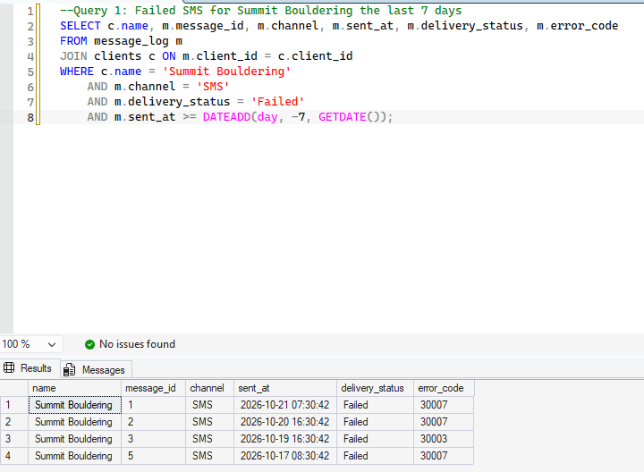

**What I would tell the customer:** I checked your message logs and found 4 failed texts this week, mostly the same carrier error. I'm escalating it to our messaging team and will update you within 24 hours.

---

## Query 2: Login issue

**The problem:** Maria at Chalk Up Fontana says she cannot log in to the dashboard.

```sql
SELECT c.name, u.email, u.is_locked, u.last_login
FROM users u
JOIN clients c ON u.client_id = c.client_id
WHERE u.email = 'maria@chalkupfontana.com';
```

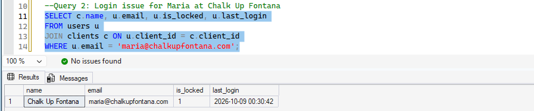

**What I would tell the customer:** Your account was locked, which is why your login kept failing, and your last successful sign in was October 9. I'm unlocking it now (see Query 9) and will confirm as soon as you can get back in.

---

## Query 3: Clients who have never opened a ticket

**The problem:** The customer success lead wants to know which clients have never contacted support, since silence can mean a client never got fully set up.

```sql
SELECT c.client_id, c.name, c.plan_tier, c.status
FROM clients c
LEFT JOIN tickets t ON c.client_id = t.client_id
WHERE t.ticket_id IS NULL;
```

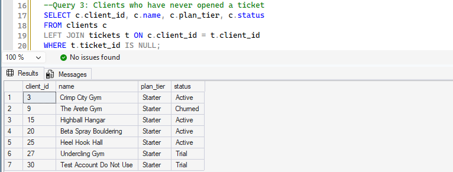

**What I would tell the team:** Seven clients have never opened a ticket, and all of them are on the Starter plan. I'd suggest a short onboarding check in with each one, starting with Undercling Gym since it's still in its trial.

---

## Query 4: Open tickets by priority

**The problem:** The support lead wants a snapshot of the open queue before the morning standup.

```sql
SELECT priority, COUNT(*) AS open_tickets
FROM tickets
WHERE status = 'Open'
GROUP BY priority
ORDER BY open_tickets DESC;
```

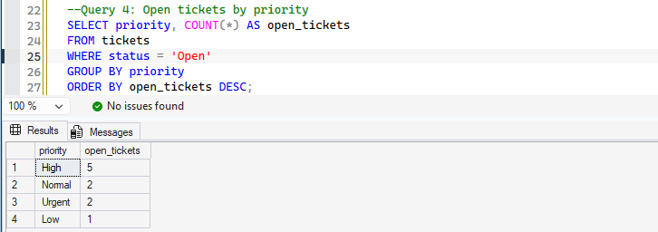

**What I would tell the team:** We have 10 open tickets: 5 High, 2 Urgent, 2 Normal, and 1 Low. I'll take the two Urgent tickets first.

---

## Query 5: Churn risk

**The problem:** An account manager asks which clients look at risk of leaving. A spike in tickets is one of the earliest warning signs.

```sql
SELECT c.name, c.plan_tier, COUNT(*) AS tickets_last_30_days
FROM tickets t
JOIN clients c ON t.client_id = c.client_id
WHERE t.created_at >= DATEADD(day, -30, GETDATE())
GROUP BY c.name, c.plan_tier
HAVING COUNT(*) >= 3
ORDER BY tickets_last_30_days DESC;
```

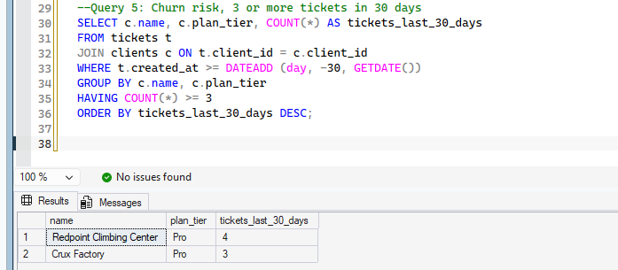

**What I would tell the team:** Redpoint Climbing Center (4 tickets) and Crux Factory (3 tickets) both crossed the threshold in the last 30 days, and both are on our Pro plan. I'd flag them for a proactive call from their account manager this week.

---

## Query 6: Average resolution time by category

**The problem:** The support manager wants to know which kinds of tickets take us the longest to resolve.

```sql
SELECT category, COUNT(*) AS solved_tickets,
    AVG(DATEDIFF(hour, created_at, resolved_at)) AS avg_hours_to_resolve
FROM tickets
WHERE status = 'Solved'
GROUP BY category
ORDER BY avg_hours_to_resolve DESC;
```

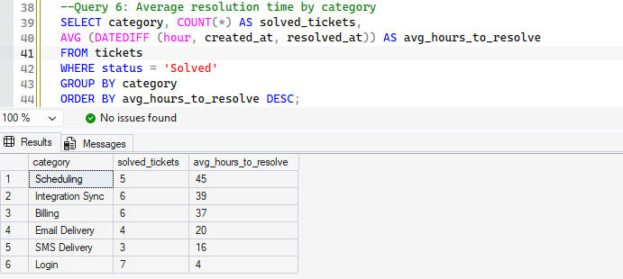

**What I would tell the team:** Scheduling tickets take the longest at about 45 hours on average, followed by Integration Sync at 39. Login issues close fastest at about 4 hours. Scheduling is where a help center article or a saved reply would save us the most time.

---

## Query 7: Delivery failure rate by channel

**The problem:** Engineering asks whether SMS or email is failing more often across all clients.

```sql
SELECT channel, COUNT(*) AS total_messages,
    SUM(CASE WHEN delivery_status = 'Failed' THEN 1 ELSE 0 END) AS failed_messages,
    CAST(100.0 * SUM(CASE WHEN delivery_status = 'Failed' THEN 1 ELSE 0 END) / COUNT(*)
        AS DECIMAL(5,1)) AS failure_rate_pct
FROM message_log
GROUP BY channel;
```

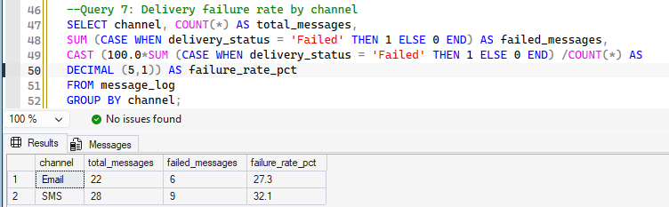

**What I would tell the team:** SMS is failing at 32.1 percent compared with 27.3 percent for email. The most common SMS error is 30007, which points to carrier filtering, so that's where I'd start.

---

## Query 8: Log a new ticket (INSERT)

**The problem:** Summit Bouldering calls in about their SMS reminders, and the agent needs to log it as a ticket.

```sql
INSERT INTO tickets (client_id, category, priority, status, created_at)
VALUES (1, 'SMS Delivery', 'High', 'Open', GETDATE());

SELECT TOP 1 ticket_id, client_id, category, priority, status, created_at
FROM tickets
ORDER BY ticket_id DESC;
```

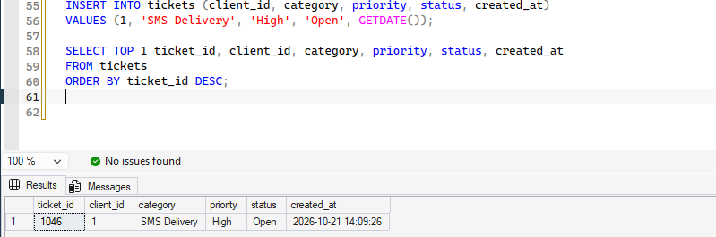

**What I would tell the customer:** I've logged ticket 1046 for your SMS delivery issue as High priority. You'll get every update on that ticket.

---

## Query 9: Unlock a user safely (UPDATE inside a transaction)

**The problem:** Maria's account from Query 2 needs to be unlocked. Before changing live data, I tested the update inside a transaction and rolled it back, then ran it for real and committed.

**Practice run with ROLLBACK.** The three results show locked (1), unlocked inside the transaction (0), then locked again (1) after the rollback undid it.

```sql
SELECT user_id, email, is_locked FROM users WHERE email = 'maria@chalkupfontana.com';
BEGIN TRANSACTION;
UPDATE users SET is_locked = 0 WHERE email = 'maria@chalkupfontana.com';
SELECT user_id, email, is_locked FROM users WHERE email = 'maria@chalkupfontana.com';
ROLLBACK TRANSACTION;
SELECT user_id, email, is_locked FROM users WHERE email = 'maria@chalkupfontana.com';
```

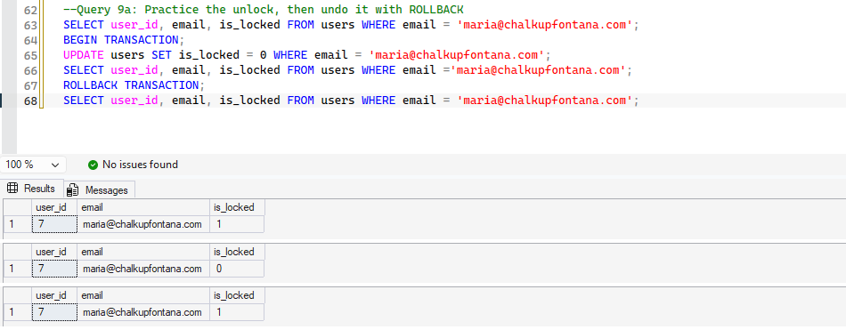

**The real change with COMMIT.**

```sql
BEGIN TRANSACTION;
UPDATE users SET is_locked = 0 WHERE email = 'maria@chalkupfontana.com';
SELECT user_id, email, is_locked FROM users WHERE email = 'maria@chalkupfontana.com';
COMMIT TRANSACTION;
```

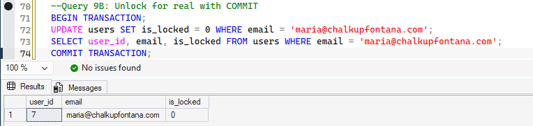

**What I would tell the customer:** Your account is unlocked and you can sign in again. If anything still blocks you, reply here and I'll stay on it with you.

---

## Query 10: Remove a test record (DELETE)

**The problem:** A test account was left in the production client list. Before deleting it, I ran a SELECT with the exact same WHERE clause to confirm it matched only that one record.

```sql
SELECT client_id, name, status FROM clients WHERE name = 'Test Account Do Not Use';
DELETE FROM clients WHERE name = 'Test Account Do Not Use';
SELECT client_id, name, status FROM clients WHERE name = 'Test Account Do Not Use';
```

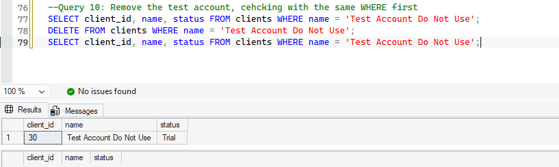

**What I would tell the team:** I confirmed the WHERE clause matched only client 30, deleted it, and checked again to verify it's gone. The client list is clean.
